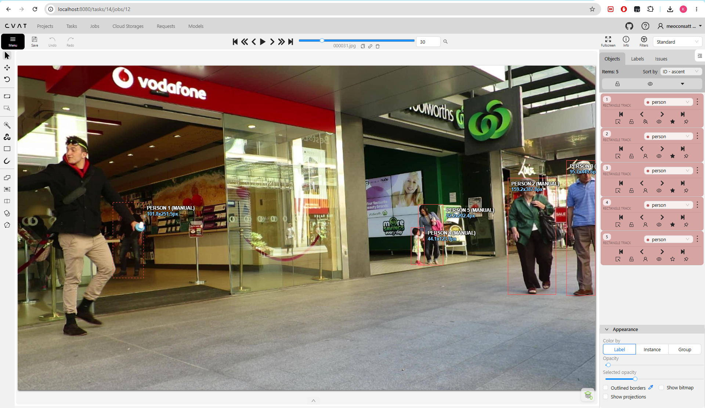
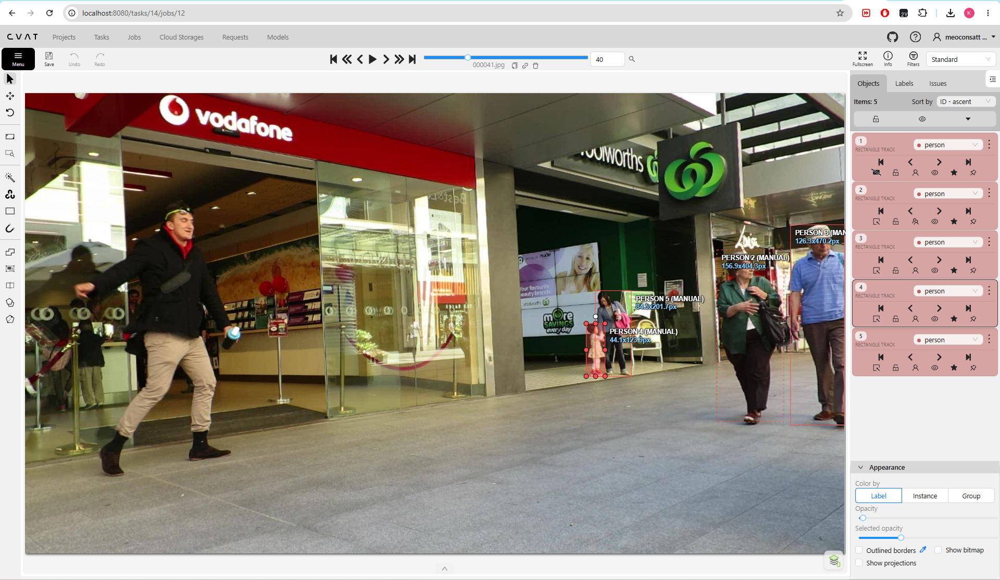
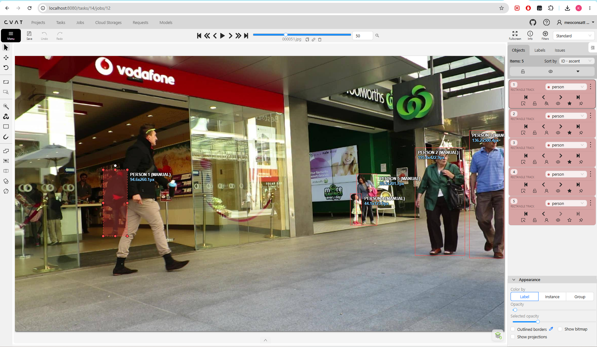

# Báo cáo cá nhân — NguyenSyKien-2A202603245

Đoạn video: MOT17-09, 150 frame (frame 1–150), nguồn MOTChallenge, giấy phép CC BY-NC-SA 3.0.

## 0. Thông tin học viên

- Họ tên: Nguyễn Sỹ Kiên
- MSSV: 2A202603245
- Mã đề (A/B/C): B
- Email: 26ai.kienns@vinuni.edu.vn
- Link repository: https://github.com/justAchillGuy8386/K5-L2-Day05-NguyenSyKien-2A202603245-MOTTracking.git
- Giờ bắt đầu: 16:30
- Giờ kết thúc: 18:15

## 1. Xem trước đoạn video (CP0)

Ghi **trước khi vẽ**, mỗi người một dòng.

| Mã | Frame xuất hiện | Frame cuối thấy được | Rẽ / dừng / đổi tốc độ ở frame | Bị che ở frame | Ghi chú |
|---|---|---|---|---|---|
| P1 | 0 | 149 | 30–35 (đổi hướng), 85–95 (bước chậm) | 25–39 (che một phần), 40–44 (che hoàn toàn) | Đi bên trong cửa hàng Vodafone, bị người đi bên ngoài che khuất |
| P2 | 0 | 149 | 0–149 (tiến thẳng lại gần camera) | 40–44 (che nhẹ cánh tay) | Đi từ góc phải xa tiến lại gần lề trái, kích thước box tăng dần |
| P3 | 0 | 149 | 0–149 (bước nhanh chéo màn hình) | Không bị che | Xuất hiện sát mép phải, tiến nhanh lại gần camera |
| P4 | 0 | 149 | 35–50 (bước chậm lại) | Không bị che | Người đi ở cự ly xa giữa khung hình, tốc độ ổn định |
| P5 | 0 | 149 | 25–45 (đi thẳng đều) | Không bị che | Đi bộ ở cự ly xa gần P4, kích thước nhỏ, chuyển động đều |

## 2. Keyframe và thời gian (CP1, CP4)

Số keyframe lấy từ kết quả `src/check_submission.py`.

| Mã | Số keyframe | Keyframe ở frame | Số frame có mặt | Keyframe / 100 frame | Thời gian (phút) | Chỗ khó |
|---|---|---|---|---|---|---|
| P1 | 31 | 0, 5, 10, 15, 20, 25, 30, 35, 40, 45, 50, 55, 60, 65, 70, 75, 80, 85, 89, 90, 95, 100, 105, 110, 115, 120, 125, 130, 135, 140, 145, 149 | 145 | 21.4 | 20 | Xử lý che khuất (occluded và outside) khi người khác đi ngang qua mặt tiền cửa hàng |
| P2 | 31 | 0, 5, 10, 15, 20, 25, 30, 35, 40, 45, 50, 55, 60, 65, 70, 75, 80, 85, 90, 95, 100, 105, 110, 115, 120, 125, 130, 135, 140, 145, 149 | 150 | 20.7 | 18 | Người di chuyển nhanh lại gần camera khiến tỷ lệ và phối cảnh box thay đổi liên tục |
| P3 | 31 | 0, 5, 10, 15, 20, 25, 30, 35, 40, 45, 50, 55, 60, 65, 70, 75, 80, 85, 90, 95, 100, 105, 110, 115, 120, 125, 130, 135, 140, 145, 149 | 150 | 20.7 | 18 | Xuất hiện từ sát mép phải frame 0, tiến nhanh lại gần, cần nắn box thường xuyên |
| P4 | 14 | 0, 5, 10, 15, 20, 25, 30, 35, 40, 45, 50, 55, 140, 145 | 150 | 9.3 | 12 | Người ở xa, vóc dáng nhỏ, cần căn chuẩn bàn chân chạm đất để tránh lệch IoU |
| P5 | 9 | 0, 5, 10, 15, 20, 25, 35, 40, 45 | 150 | 6.0 | 10 | Người ở xa, đi thẳng đều nên sau khi nội suy ít phải chỉnh thêm |
| **Tổng** | 116 | - | 745 | 15.6 | 78 | |

Keyframe / 100 frame của cả bài = tổng keyframe ÷ tổng số frame có mặt × 100 = 116 ÷ 745 × 100 = 15.6 keyframe / 100 frame.

Bạn đặt keyframe nhiều nhất ở người nào? Vì sao (người đó rẽ, dừng, lại gần camera hay bị che)?

Em đặt keyframe nhiều nhất ở P1 (31 keyframe), P2 (31 keyframe) và P3 (31 keyframe). Trong đó:
- **P1** có mật độ keyframe cao nhất (21.4 KF/100 frame) vì đối tượng này đi bên trong cửa hàng, có các pha đổi hướng và đặc biệt là bị che khuất hoàn toàn bởi người đi bên ngoài; đòi hỏi phải cắm keyframe dày tại các mốc bắt đầu che, bật `outside`, hiện lại và phục hồi box nhìn rõ.
- **P2 và P3** có số lượng keyframe nhiều (31 keyframe) vì cả hai người đều di chuyển từ cự ly xa bên phải tiến thẳng lại gần góc dưới camera, khiến kích thước bounding box phóng to gấp 3–4 lần. Nếu để khoảng cách keyframe quá thưa, phép nội suy tuyến tính sẽ làm box bị co/nở không đồng đều so với người thật.

## 3. Đoạn bị che (CP2)

Người bị che: `P1`

| Mốc | Frame |
|---|---:|
| Bắt đầu bị che một phần (bật `occluded`) | 25 |
| Mất hẳn (bật `outside`) | 40 |
| Hiện lại (tắt `outside`) | 45 |
| Thấy rõ trở lại (tắt `occluded`) | 55 |

- Thời gian khuất hẳn: 5 frame = 0.17 giây (tính theo chuẩn 30 fps).
- Quyết định: giữ cùng ID (`Track ID 1`).
- Lý do (trả lời 3 câu: khuất bao lâu so với 60 frame, ngoại hình có khớp, chỗ hiện lại có đúng hướng và tốc độ):
  1. Thời gian khuất hẳn là 5 frame (≈ 0.17s), nhỏ hơn rất nhiều so với ngưỡng 60 frame (2 giây) quy ước của lớp.
  2. Ngoại hình khi xuất hiện lại hoàn toàn trùng khớp (vẫn là người mặc áo tối màu bên trong cửa hàng Vodafone).
  3. Vị trí tái xuất hiện ở frame 45 hoàn toàn khớp với vector hướng đi từ trái sang phải và vận tốc bước chân trước khi bị che.

Ảnh chụp màn hình:





## 4. Tự review ID (CP3)

Lượt 1 theo người (đi ngược từ frame 149 về 0 trên CVAT), lượt 2 theo cảnh (nhảy 10 frame). Ít nhất 3 dòng; không có lỗi thì ghi một dòng "đã kiểm hai lượt, không lỗi".

Loại lỗi dùng đúng một trong 7 mã: `id_switch`, `fragmentation`, `lost`, `merge`, `false_track`, `drift`, `flag`.

| Frame | Mã người | Loại lỗi | Mô tả một câu | Phát hiện ở lượt | Đã sửa? |
|---:|---|---|---|---|---|
| 40 | P1 | `flag` | Chưa bật outside ở frame mất hẳn khiến box bị giữ nguyên vô căn cứ | Lượt 1 | Có, đã bật outside từ frame 40 đến 44 |
| 30 | P1 | `drift` | Box nội suy bị trôi lệch khỏi thân người do người quay người nhẹ | Lượt 1 | Có, đã thêm keyframe tại frame 30 và 35 để nắn box |
| 75 | P2 | `drift` | Box hơi nhỏ hơn thân người do người tiến gần camera nhanh | Lượt 2 | Có, đã chỉnh lại kích thước box tại keyframe 75 |
| 45 | P1 | `id_switch` | Suýt bị vẽ thành track mới khi người xuất hiện trở lại | Lượt 2 | Có, đã giữ nguyên Track 1 cũ và tắt outside |

Tổng hợp số lỗi theo loại:

| `id_switch` | `fragmentation` | `lost` | `merge` | `false_track` | `drift` | `flag` |
|---:|---:|---:|---:|---:|---:|---:|
| 1 | 0 | 0 | 0 | 0 | 2 | 1 |

Lỗi nào chỉ lượt 2 (theo cảnh) mới thấy, lượt 1 (theo người) không thấy? Vì sao?

Lỗi suýt bị đổi ID (`id_switch`) và lỗi box bị lệch tương đối giữa hai người đi cắt nhau chỉ lượt 2 (theo cảnh) mới phát hiện rõ. Khi thực hiện lượt 1 (soát theo từng người), mắt người tập trung hoàn toàn vào một cá nhân riêng lẻ nên dễ bỏ sót các tương tác không gian xung quanh. Ở lượt 2 (nhìn toàn cảnh cả 5 box cùng lúc), ta dễ dàng đối chiếu mối tương quan vị trí, nhận ra ngay nếu có hai box bị chồng chéo (`merge`), có box lạ xuất hiện đột ngột hoặc track bị nhảy sang người khác.

## 5. File xuất và kết quả tự kiểm (CP4)

| Kiểm tra | Kết quả |
|---|---|
| Tên file MOT 1.1 | `NguyenSyKien_mot.zip` |
| Tên file CVAT for video 1.1 | `NguyenSyKien_cvat_video.zip` |
| Số track ID khác nhau trong `gt/gt.txt` (phải là 5) | 5 track ID |
| Frame `outside` không có dòng trong `gt.txt` (đúng / sai) | Đúng (frame 40–44 không có dòng nào của Track 1) |
| Job đã completed trên CVAT máy cá nhân | Đúng |

Dán phần tóm tắt in ra từ `src/check_submission.py`:

```text
Số frame in theo CVAT (bắt đầu từ 0). Trong gt.txt, frame_id = frame CVAT + 1.

=== File MOT 1.1: NguyenSyKien_mot.zip ===
  Số track ID: 5   |   Tổng số box: 745
  [OK]        Đúng 5 track ID.

  Track | Frame có mặt | Số frame | Đoạn vắng (outside)
      1 |   0–149      |      145 | 40–44
      2 |   0–149      |      150 | -
      3 |   0–149      |      150 | -
      4 |   0–149      |      150 | -
      5 |   0–149      |      150 | -


=== File CVAT for video 1.1: NguyenSyKien_cvat_video.zip ===

  Track | Nhãn   | Frame thấy | Keyframe | KF/100 frame | Frame occluded | Lần bật outside
      0 | person |        145 |       31 |         21.4 |             50 |               1
              Track 0: keyframe ở frame [0, 5, 10, 15, 20, 25, 30, 35, 45, 50, 55, 60, 65, 70, 75, 80, 85, 89, 90, 95, 100, 105, 110, 115, 120, 125, 130, 135, 140, 145, 149]
      1 | person |        150 |       31 |         20.7 |              5 |               0
              Track 1: keyframe ở frame [0, 5, 10, 15, 20, 25, 30, 35, 40, 45, 50, 55, 60, 65, 70, 75, 80, 85, 90, 95, 100, 105, 110, 115, 120, 125, 130, 135, 140, 145, 149]
      2 | person |        150 |       31 |         20.7 |              0 |               0
              Track 2: keyframe ở frame [0, 5, 10, 15, 20, 25, 30, 35, 40, 45, 50, 55, 60, 65, 70, 75, 80, 85, 90, 95, 100, 105, 110, 115, 120, 125, 130, 135, 140, 145, 149]
      3 | person |        150 |       14 |          9.3 |              0 |               0
              Track 3: keyframe ở frame [0, 5, 10, 15, 20, 25, 30, 35, 40, 45, 50, 55, 140, 145]
      4 | person |        150 |        9 |          6.0 |              0 |               0
              Track 4: keyframe ở frame [0, 5, 10, 15, 20, 25, 35, 40, 45]

  Tổng: 116 keyframe / 745 frame có mặt = 15.6 keyframe / 100 frame
  [OK]        Đọc được 5 track từ annotations.xml.

=== Tóm tắt ===
  Lỗi: 0   |   Cảnh báo: 0
  Đạt. Dán phần tóm tắt này vào báo cáo mục 5.
```

## 6. Ba câu kết

1. Nếu được gán lại, bạn sẽ đặt keyframe khác ở đâu? Vì sao?

   Nếu được gán lại, em sẽ tối ưu hóa việc đặt keyframe ở P4 và P5 bằng cách kéo giãn khoảng cách giữa các keyframe ra khoảng 15–20 frame ở nửa sau video (frame 60–140), vì ở cự ly xa hai người này di chuyển với vận tốc gần như không đổi và kích thước thay đổi rất ít; điều này giúp tiết kiệm công sức mà box vẫn đảm bảo IoU ≥ 0.7. Ngược lại, với P2 và P3 khi lại gần camera ở các frame cuối, em sẽ duy trì mật độ 5 frame/keyframe để bám sát sự phóng to của góc nhìn phối cảnh.

2. Có chỗ nào bạn không chắc "cùng ID hay ID mới"? Bạn đã quyết định và ghi chú thế nào?

   Vị trí phân vân nhất là khi P1 bị che hoàn toàn ở frame 40–44 phía sau lưng người đi bộ bên ngoài. Tuy nhiên, căn cứ vào quy ước 2 giây (60 frame) của lớp, thời gian người này biến mất chỉ vỏn vẹn 5 frame (≈ 0.17 giây), hướng đi và quần áo khi xuất hiện lại ở frame 45 hoàn toàn trùng khớp với trước khi che, nên em đã tự tin giữ nguyên cùng Track ID 1 bằng cách sử dụng thuộc tính `outside` thay vì tạo track mới.

3. Một lỗi ID trong job của bạn (nếu không còn sót, chọn lỗi đã sửa) có thể làm xe tự lái dự đoán sai chuyển động của người đó như thế nào? Lỗi đó ảnh hưởng MOTA hay IDF1 nhiều hơn?

   Nếu để xảy ra lỗi `id_switch` hoặc tách track (`fragmentation`) tại frame 45 khi P1 xuất hiện lại, module dự đoán quỹ đạo (trajectory forecasting) của hệ thống xe tự lái sẽ xem người xuất hiện lại là một chướng ngại vật hoàn toàn mới vừa xuất hiện đột ngột hoặc tính sai vector vận tốc (do vị trí nhảy vọt giữa hai frame liên tiếp). Điều này có thể khiến xe đưa ra quyết định phanh gấp hoặc đánh lái khẩn cấp không cần thiết, gây nguy hiểm cho hành khách và các phương tiện xung quanh.
   Lỗi này sẽ ảnh hưởng đến **IDF1 nhiều hơn đáng kể so với MOTA**. Lý do là vì MOTA chỉ trừ 1 điểm phạt cho một lần chuyển đổi ID (tương tự như 1 lỗi detection cục bộ), trong khi IDF1 đo lường tính nhất quán của định danh danh tính (Identity Consistency) xuyên suốt toàn bộ vòng đời của đối tượng. Khi một ID bị gãy đôi, toàn bộ trọng số gán đúng danh tính của track đó sẽ bị chia nhỏ, kéo điểm số IDF1 tụt dốc nghiêm trọng.

## 7. Tài liệu tham khảo và công cụ AI đã dùng

- Bộ dữ liệu `MOT17-09` (Milan et al., 2016, MOTChallenge), giấy phép CC BY-NC-SA 3.0.
- Tài liệu hướng dẫn thực hành Lab Ngày 5, CVAT Documentation & Guideline môn học.
- Trợ lý AI (Google DeepMind / Antigravity) được sử dụng để hỗ trợ tra cứu cú pháp công thức MOTA/IDF1, phân tích định dạng file xuất của CVAT và chạy script kiểm tra tự động `check_submission.py`.

